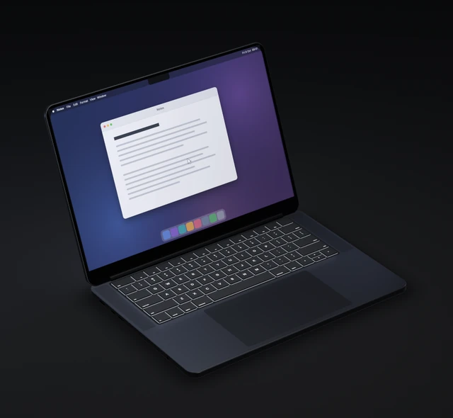

<h1 align="center">Dimmer</h1>
<p align="center">Your MacBook's keyboard backlight and screen dim as you close the lid, and are off before it shuts.</p>
<p align="center">
  <a href="https://github.com/kalkman-code/dimmer/releases/latest"></a>
  <a href="LICENSE"></a>
  
</p>

<p align="center"></p>

<p align="center">
  <a href="https://github.com/kalkman-code/dimmer/releases/download/v1.4.3/Dimmer-1.4.3.dmg"><b>Download Dimmer 1.4.3</b></a><br>
  macOS 14 or later · signed and notarised by Apple · free, GPL-3.0 · <a href="https://github.com/kalkman-code/dimmer/releases/tag/v1.4.3">release notes</a>
</p>

Dimmer is a small menu bar app. It reads the lid angle from the MacBook's hinge sensor and sets the
keyboard backlight and screen from it, on ranges you set yourself.

## What it does

- Fades the keyboard and screen from full with the lid at 100 degrees to off at 68 by default. Drag or type each end's angle and brightness in Settings, where every feature has its own box and bar, or switch either off and its box folds away.
- Puts your brightness back when you open the lid, pause or quit, and the keyboard backlight when the Mac sleeps, automatic keyboard brightness included.
- While Privacy veil is on, press Ctrl+Cmd+P in any app and every screen frosts over until you type, touch the trackpad or lift the lid. Snap to blur, off by default, does the same when you snap the lid down quickly.
- Each blur box has a `Look` menu with `Frost`, `Mist`, `Slate`, `Smoke` and `Charcoal`. Snap to blur and Privacy veil set blur strength and tint together; Blur by angle sets tint while keeping its range. Editing a look's controls selects `Custom`.
- Blur by angle, off by default, adds a bar that frosts the screen more the further the lid closes, between two angles you set. Its `Tint` control darkens the angle veil in proportion to its blur strength. Settings can undo each control and restore the range and tint together.
- Snap to blur and Privacy veil have separate blur strengths. Snap to blur, Blur by angle and Privacy veil each have their own preview; Snap to blur has its own `Tint` control, shown only while snap is on, and Privacy veil has a separate tint for the shortcut veil. When snap and angle blur overlap, the stronger strength sets the blur and the greater strength-weighted tint sets the darkness.
- Restore links are scoped to their boxes: Snap restores its zone, snap distance, speed, blur strength and tint; Blur restores its range and tint; Privacy veil restores its own blur strength, clear speed and shortcut tint while leaving Snap tint and the shortcut assignment unchanged.
- Go dark fades the keyboard and screen off without moving the lid (it can also have its own shortcut, unassigned by default); Keep awake holds the Mac awake on a timer or indefinitely. Both are in the menu bar panel.
- Steps aside when you change the keyboard brightness yourself, and leaves the keyboard dark when macOS has dimmed it for inactivity.
- VoiceOver can read and set every value. With an endpoint focused, left and right change its angle by 1 degree and up and down change its brightness by 5 percentage points; for snap-zone endpoints, up and down change Snap to blur strength by 5 points while left and right still change the angle. Exact typing keeps normal caret behaviour. Reduce Motion and Reduce Transparency are respected.

## Requirements

- macOS 14 or later. A readable lid-angle sensor is required for keyboard and screen dimming, Snap to blur and Blur by angle. Without one, those angle controls are unavailable and no lid polling timer runs; Privacy veil, Go dark and Keep awake still work. Go dark wakes from keyboard or pointer input because lid movement cannot be detected.
- Tested on one machine: a 16-inch MacBook Pro with M1 Max (2021) on macOS 27.2.
- The app is universal, but Intel is untested. Only an Intel MacBook with the hinge sensor can work, reportedly the 2019 16-inch MacBook Pro onwards. A bug report saying whether it worked is welcome either way.

Dimmer relies on interfaces Apple does not document, so a macOS update can break it without notice. [How it works](HOW-IT-WORKS.md) lists them.

## Privacy

Dimmer asks for no Accessibility, Input Monitoring or Screen Recording permission, and has no account,
analytics or telemetry. It notices typing and the trackpad from macOS's idle counters, which say only
that input happened, and the blur is a standard frosted layer, not a capture of your screen. Only
Launch at Login may need you to allow it in System Settings.

Since 1.3 Dimmer can check for updates, and that is its only network connection. Checks are off until
you agree: on its second launch Dimmer asks whether to check automatically. If you say yes, once a day
it fetches a small signed file, `https://kalkmancode.co.uk/dimmer/appcast.xml`, that lists the latest
version. The request carries what any web request does, your IP address, your preferred language and
a User-Agent naming Dimmer's version and Sparkle's, and nothing about your Mac or how you use Dimmer. Downloading an update
fetches it from GitHub. Check for updates… checks once, when you choose it. Settings → Updates turns
automatic checks off again, and with them off Dimmer connects to nothing until you check by hand.
Installing stays your choice unless you also turn on Install updates automatically.

## Languages

English, Spanish, Portuguese, German, French and Japanese, following your Mac's language.

## Install

1. Download [`Dimmer-1.4.3.dmg`](https://github.com/kalkman-code/dimmer/releases/download/v1.4.3/Dimmer-1.4.3.dmg).
2. Open it and drag Dimmer to Applications.
3. Open Dimmer. Its icon, a diamond cut across by a line, appears in the menu bar: click it for the panel, right-click for Settings, About, Check for updates…, Go dark, Pause and Quit. The diamond turns to an outline while paused. The first time, Settings opens with a short welcome and offers Launch at Login.

Dimmer 1.2.1 and earlier cannot update themselves: install 1.4.3 by hand once, the same way, dragging it
over the old copy in Applications. From 1.3 on, Dimmer offers updates itself. Sparkle normally checks
the signed feed and the downloaded app against Dimmer's update key, and checks the new app's Apple code
signature. After 20 days of failed feed-signature checks, Sparkle may offer an update with reduced feed
protection; the download and Apple code-signature checks still apply. Sparkle does not check notarisation
itself; releases are notarised before they are published.

To check the download, compare `shasum -a 256 Dimmer-1.4.3.dmg` with
[`SHA256SUMS`](https://github.com/kalkman-code/dimmer/releases/download/v1.4.3/SHA256SUMS) on the release.

## Uninstall

The panel's More → Uninstall Dimmer… walks you through it. In short: turn off Launch at Login in
Settings, choose Quit Dimmer so it puts your brightness back (even if macOS has dimmed the
keyboard for inactivity), then move Dimmer from Applications to the Bin.

Optional leftovers, once it has quit with brightness restored:
`~/Library/Preferences/uk.co.kalkmancode.Dimmer.plist`,
`~/Library/Application Support/Dimmer/keyboard-recovery.json` and
`~/Library/Application Support/Dimmer/display-recovery.json`; the Application Support folder can go too if it is then empty. If brightness did not come back, keep
the recovery files and reopen Dimmer with the keyboard awake before trying again.

## Build from source

You need a release (not beta) Xcode 16 or later, for the Swift 6 tools.

```sh
git clone https://github.com/kalkman-code/dimmer.git
cd dimmer
scripts/build-app.sh
open build/Dimmer.app
```

`scripts/build-app.sh` builds the release binary and assembles an ad hoc signed `build/Dimmer.app`,
with Sparkle's framework and helpers embedded and signed from the inside out. Set
`DIMMER_SIGN_IDENTITY` to a Developer ID identity to sign with the hardened runtime for notarisation.
`swift test` runs the tests.

## Contributing and bug reports

Forks and pull requests are welcome. To report a bug, use the
[bug report form](https://github.com/kalkman-code/dimmer/issues/new?template=bug_report.yml).
About Dimmer, in the menu bar icon's right-click menu, shows your version, build, macOS and Mac
model, with a button that copies them; the form asks for those and what the panel shows.

## Licence

GPL-3.0. See [LICENSE](LICENSE). Dimmer is not affiliated with or endorsed by Apple.

If Dimmer helps, [buy me a coffee](https://kalkmancode.co.uk/coffee/).

The privacy shortcut uses [KeyboardShortcuts](https://github.com/sindresorhus/KeyboardShortcuts)
by Sindre Sorhus, under the MIT licence. Updates use [Sparkle](https://sparkle-project.org) 2.10.0,
under the MIT licence with BSD and zlib component notices. Both notices are included in the app's
resources.

The angles, the privacy veil, recovery, settings carried over from earlier versions and the
private interfaces Dimmer uses are in [How it works](HOW-IT-WORKS.md).
